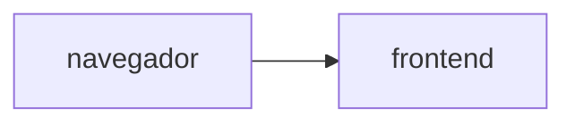

# Muro de mensajes

**Equipo:** Angely Sofia Pino (1152315), Jhan Ávila Torres (1152490)  
**Proyecto de Google Cloud:** `nube-practica-1-507220`  
**URL del muro:**

## Diagrama



## Fase 0. Preparación

### Evidencia 0

Versiones de Terraform y Docker, e instalación de `hey` en Cloud Shell, y `gcloud config list` mostrando el proyecto activo.


Comandos ejecutados:

```text
jhan_4_fran_t@cloudshell:~/practica-4-muro (nube-practica-1-507220)$ terraform version
Terraform v1.5.7
on linux_amd64

Your version of Terraform is out of date! The latest version
is 1.16.5. You can update by downloading from https://www.terraform.io/downloads.html
jhan_4_fran_t@cloudshell:~/practica-4-muro (nube-practica-1-507220)$ docker version
Client: Docker Engine - Community
 Version:           29.9.0
 API version:       1.56
 Go version:        go1.26.9
 Git commit:        f415da8
 Built:             Thu Oct  8 20:38:42 2026
 OS/Arch:           linux/amd64
 Context:           default

Server: Docker Engine - Community
 Engine:
  Version:          29.8.2
  API version:      1.56 (minimum version 1.40)
  Go version:       go1.26.8
  Git commit:       8af9fe3
  Built:            Wed Sep 30 19:32:28 2026
  OS/Arch:          linux/amd64
  Experimental:     false
 containerd:
  Version:          v2.3.6
  GitCommit:        ee2735368117d2eb259779949d5e75cdafec9761
 runc:
  Version:          1.5.2
  GitCommit:        v1.5.2-0-g29dd3dc2
 docker-init:
  Version:          0.19.0
  GitCommit:        de40ad0
jhan_4_fran_t@cloudshell:~/practica-4-muro (nube-practica-1-507220)$ go install github.com/rakyll/hey@latest
go: downloading github.com/rakyll/hey v0.1.5
go: downloading golang.org/x/net v0.48.0
go: downloading golang.org/x/text v0.33.0
jhan_4_fran_t@cloudshell:~/practica-4-muro (nube-practica-1-507220)$ gcloud config list
[core]
account = jhan.4.fran.t@gmail.com
disable_usage_reporting = True
project = nube-practica-1-507220
universe_domain = googleapis.com

Your active configuration is: [cloudshell-30179]
```

## Fase 1. Las imágenes

## Fase 2. Los cimientos

## Fase 3. El backend

## Fase 4. El frontend, conectado

## Fase 5. El estado vive afuera

## Fase 6. Reto

### Decisiones

### Preguntas
