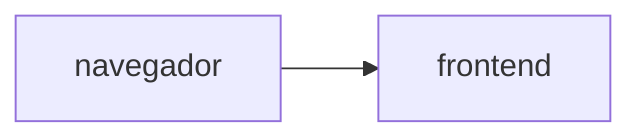

# Muro de mensajes

**Equipo:** Angely Sofia Pino (1152315), Jhan Ávila Torres (1152490)  
**Proyecto de Google Cloud:** `nube-practica-1-507220`  
**URL del muro:**

## Diagrama



## Fase 0. Preparación

### Evidencia 0

Versiones de Terraform y Docker, e instalación de `hey` en Cloud Shell, y `gcloud config list` mostrando el proyecto activo.


Comandos ejecutados:

```text
jhan_4_fran_t@cloudshell:~/practica-4-muro (nube-practica-1-507220)$ terraform version
Terraform v1.5.7
on linux_amd64

Your version of Terraform is out of date! The latest version
is 1.16.5. You can update by downloading from https://www.terraform.io/downloads.html
jhan_4_fran_t@cloudshell:~/practica-4-muro (nube-practica-1-507220)$ docker version
Client: Docker Engine - Community
 Version:           29.9.0
 API version:       1.56
 Go version:        go1.26.9
 Git commit:        f415da8
 Built:             Thu Oct  8 20:38:42 2026
 OS/Arch:           linux/amd64
 Context:           default

Server: Docker Engine - Community
 Engine:
  Version:          29.8.2
  API version:      1.56 (minimum version 1.40)
  Go version:       go1.26.8
  Git commit:       8af9fe3
  Built:            Wed Sep 30 19:32:28 2026
  OS/Arch:          linux/amd64
  Experimental:     false
 containerd:
  Version:          v2.3.6
  GitCommit:        ee2735368117d2eb259779949d5e75cdafec9761
 runc:
  Version:          1.5.2
  GitCommit:        v1.5.2-0-g29dd3dc2
 docker-init:
  Version:          0.19.0
  GitCommit:        de40ad0
jhan_4_fran_t@cloudshell:~/practica-4-muro (nube-practica-1-507220)$ go install github.com/rakyll/hey@latest
go: downloading github.com/rakyll/hey v0.1.5
go: downloading golang.org/x/net v0.48.0
go: downloading golang.org/x/text v0.33.0
jhan_4_fran_t@cloudshell:~/practica-4-muro (nube-practica-1-507220)$ gcloud config list
[core]
account = jhan.4.fran.t@gmail.com
disable_usage_reporting = True
project = nube-practica-1-507220
universe_domain = googleapis.com

Your active configuration is: [cloudshell-30179]
```

## Fase 1. Las imágenes

### Evidencia 1

**1.1** Vista previa del frontend en el puerto 8080: la página carga, pero todavía no hay backend.


**1.2** Segunda construcción del backend tras cambiar el comentario de `app.py`: `pip install` sale de la caché (`CACHED [4/5]`) y solo se reconstruye la capa `COPY app.py`.


Comandos ejecutados:

```text
jhan_4_fran_t@cloudshell:~/practica-4-muro (nube-practica-1-507220)$ docker build -t backend:local backend
[+] Building 0.8s (10/10) FINISHED  docker:default
 => [internal] load build definition from Dockerfile  0.0s
 => => transferring dockerfile: 241B  0.0s
 => [internal] load metadata for docker.io/library/python:3.14-slim  0.3s
 => [internal] load .dockerignore  0.0s
 => => transferring context: 2B  0.0s
 => [1/5] FROM docker.io/library/python:3.14-slim@sha256:a2b82f3c48559aa0a8446d9af49826b6e2b2016f4cd2afabfe6013ec53729170  0.0s
 => => resolve docker.io/library/python:3.14-slim@sha256:a2b82f3c48559aa0a8446d9af49826b6e2b2016f4cd2afabfe6013ec53729170  0.0s
 => [internal] load build context  0.0s
 => => transferring context: 1.54kB  0.0s
 => CACHED [2/5] WORKDIR /app  0.0s
 => CACHED [3/5] COPY requirements.txt .  0.0s
 => CACHED [4/5] RUN pip install --no-cache-dir -r requirements.txt  0.0s
 => [5/5] COPY app.py .  0.0s
 => exporting to image  0.3s
 => => exporting layers  0.1s
 => => exporting manifest sha256:8c5f34b3df42db154c20f995c153af2fe4de2a8bb88b12394c61d51b6542e37d  0.0s
 => => exporting config sha256:4e361546404aaa28abc108a6fa24dce4080f47d3cdbf8fe8a809d98316336493  0.0s
 => => exporting attestation manifest sha256:2aa4a2f4a0cb9dbf8c9eec1598340f87f420524a0a7700451ddb8cb12dbb189a  0.0s
 => => exporting manifest list sha256:28d675c42cf0aa1aa5b9d208f178efe0c9eab208b1eb302205a727616894aa43  0.0s
 => => naming to docker.io/library/backend:local  0.0s
 => => unpacking to docker.io/library/backend:local  0.0s

 1 warning found (use docker --debug to expand):
 - JSONArgsRecommended: JSON arguments recommended for CMD to prevent unintended behavior related to OS signals (line 7)
```

Construcción del frontend y prueba local (vista previa de Cloud Shell en el puerto 8080, evidencia 1.1):

```bash
docker build -t frontend:local frontend
docker run -d --rm --name front -p 8080:8080 frontend:local
docker stop front
```

Para la evidencia 1.2 se cambió una palabra del comentario de la primera línea de `backend/app.py` y se volvió a ejecutar `docker build -t backend:local backend`.

## Fase 2. Los cimientos

## Fase 3. El backend

## Fase 4. El frontend, conectado

## Fase 5. El estado vive afuera

## Fase 6. Reto

### Decisiones

### Preguntas
