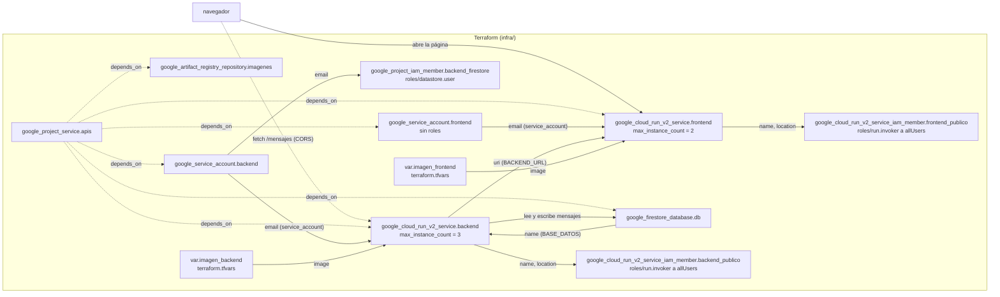

# Muro de mensajes

**Equipo:** Angely Sofia Pino (1152315), Jhan Ávila Torres (1152490)  
**Proyecto de Google Cloud:** `nube-practica-1-507220`  
**URL del muro:** https://pinoavila-frontend-q7vhrsuaoa-uc.a.run.app/

## Diagrama



## Fase 0. Preparación

### Evidencia 0

Versiones de Terraform y Docker, e instalación de `hey` en Cloud Shell, y `gcloud config list` mostrando el proyecto activo.


Comandos ejecutados:

```text
jhan_4_fran_t@cloudshell:~/practica-4-muro (nube-practica-1-507220)$ terraform version
Terraform v1.5.7
on linux_amd64

Your version of Terraform is out of date! The latest version
is 1.16.5. You can update by downloading from https://www.terraform.io/downloads.html
jhan_4_fran_t@cloudshell:~/practica-4-muro (nube-practica-1-507220)$ docker version
Client: Docker Engine - Community
 Version:           29.9.0
 API version:       1.56
 Go version:        go1.26.9
 Git commit:        f415da8
 Built:             Thu Oct  8 20:38:42 2026
 OS/Arch:           linux/amd64
 Context:           default

Server: Docker Engine - Community
 Engine:
  Version:          29.8.2
  API version:      1.56 (minimum version 1.40)
  Go version:       go1.26.8
  Git commit:       8af9fe3
  Built:            Wed Sep 30 19:32:28 2026
  OS/Arch:          linux/amd64
  Experimental:     false
 containerd:
  Version:          v2.3.6
  GitCommit:        ee2735368117d2eb259779949d5e75cdafec9761
 runc:
  Version:          1.5.2
  GitCommit:        v1.5.2-0-g29dd3dc2
 docker-init:
  Version:          0.19.0
  GitCommit:        de40ad0
jhan_4_fran_t@cloudshell:~/practica-4-muro (nube-practica-1-507220)$ go install github.com/rakyll/hey@latest
go: downloading github.com/rakyll/hey v0.1.5
go: downloading golang.org/x/net v0.48.0
go: downloading golang.org/x/text v0.33.0
jhan_4_fran_t@cloudshell:~/practica-4-muro (nube-practica-1-507220)$ gcloud config list
[core]
account = jhan.4.fran.t@gmail.com
disable_usage_reporting = True
project = nube-practica-1-507220
universe_domain = googleapis.com

Your active configuration is: [cloudshell-30179]
```

## Fase 1. Las imágenes

### Evidencia 1

**1.1** Vista previa del frontend en el puerto 8080: la página carga, pero todavía no hay backend.


**1.2** Segunda construcción del backend tras cambiar el comentario de `app.py`: `pip install` sale de la caché (`CACHED [4/5]`) y solo se reconstruye la capa `COPY app.py`.


Comandos ejecutados:

```text
jhan_4_fran_t@cloudshell:~/practica-4-muro (nube-practica-1-507220)$ docker build -t backend:local backend
[+] Building 0.8s (10/10) FINISHED  docker:default
 => [internal] load build definition from Dockerfile  0.0s
 => => transferring dockerfile: 241B  0.0s
 => [internal] load metadata for docker.io/library/python:3.14-slim  0.3s
 => [internal] load .dockerignore  0.0s
 => => transferring context: 2B  0.0s
 => [1/5] FROM docker.io/library/python:3.14-slim@sha256:a2b82f3c48559aa0a8446d9af49826b6e2b2016f4cd2afabfe6013ec53729170  0.0s
 => => resolve docker.io/library/python:3.14-slim@sha256:a2b82f3c48559aa0a8446d9af49826b6e2b2016f4cd2afabfe6013ec53729170  0.0s
 => [internal] load build context  0.0s
 => => transferring context: 1.54kB  0.0s
 => CACHED [2/5] WORKDIR /app  0.0s
 => CACHED [3/5] COPY requirements.txt .  0.0s
 => CACHED [4/5] RUN pip install --no-cache-dir -r requirements.txt  0.0s
 => [5/5] COPY app.py .  0.0s
 => exporting to image  0.3s
 => => exporting layers  0.1s
 => => exporting manifest sha256:8c5f34b3df42db154c20f995c153af2fe4de2a8bb88b12394c61d51b6542e37d  0.0s
 => => exporting config sha256:4e361546404aaa28abc108a6fa24dce4080f47d3cdbf8fe8a809d98316336493  0.0s
 => => exporting attestation manifest sha256:2aa4a2f4a0cb9dbf8c9eec1598340f87f420524a0a7700451ddb8cb12dbb189a  0.0s
 => => exporting manifest list sha256:28d675c42cf0aa1aa5b9d208f178efe0c9eab208b1eb302205a727616894aa43  0.0s
 => => naming to docker.io/library/backend:local  0.0s
 => => unpacking to docker.io/library/backend:local  0.0s

 1 warning found (use docker --debug to expand):
 - JSONArgsRecommended: JSON arguments recommended for CMD to prevent unintended behavior related to OS signals (line 7)
```

Construcción del frontend y prueba local (vista previa de Cloud Shell en el puerto 8080, evidencia 1.1):

```bash
docker build -t frontend:local frontend
docker run -d --rm --name front -p 8080:8080 frontend:local
docker stop front
```

Para la evidencia 1.2 se cambió una palabra del comentario de la primera línea de `backend/app.py` y se volvió a ejecutar `docker build -t backend:local backend`.

## Fase 2. Los cimientos

### Evidencia 2

**2.1** Repositorio `pinoavila-imagenes` en Artifact Registry (formato Docker) con las imágenes `backend` y `frontend`.


**2.2** Base de datos `pinoavila-db` en Firestore, vacía (la colección `mensajes` aparece con el primer documento, en la fase 3).


**2.3** Cuenta de servicio `pinoavila-backend@nube-practica-1-507220.iam.gserviceaccount.com` en IAM, con el rol *Usuario de Cloud Datastore* (`roles/datastore.user`) y ningún otro.


### Comandos ejecutados

Paso previo, una sola vez:

```bash
gcloud services enable cloudresourcemanager.googleapis.com --project nube-practica-1-507220
```

Infraestructura (desde `infra/`):

```bash
terraform apply
```

```text
Plan: 9 to add, 0 to change, 4 to destroy.
google_project_service.apis["cloudresourcemanager.googleapis.com"]: Creating...
google_service_account.backend: Creating...
google_firestore_database.db: Creating...
google_artifact_registry_repository.imagenes: Creating...
google_firestore_database.db: Creation complete after 1s [id=projects/nube-practica-1-507220/databases/pinoavila-db]
google_artifact_registry_repository.imagenes: Creation complete after 11s [id=projects/nube-practica-1-507220/locations/us-central1/repositories/pinoavila-imagenes]
google_service_account.backend: Creation complete after 15s [id=projects/nube-practica-1-507220/serviceAccounts/pinoavila-backend@nube-practica-1-507220.iam.gserviceaccount.com]
google_project_iam_member.backend_firestore: Creation complete after 8s [id=nube-practica-1-507220/roles/datastore.user/serviceAccount:pinoavila-backend@nube-practica-1-507220.iam.gserviceaccount.com]

Apply complete! Resources: 9 added, 0 changed, 4 destroyed.

Outputs:

ruta_registro = "us-central1-docker.pkg.dev/nube-practica-1-507220/pinoavila-imagenes"
```

Imágenes (desde la raíz del repositorio):

```bash
RUTA=$(terraform -chdir=infra output -raw ruta_registro)
gcloud auth configure-docker us-central1-docker.pkg.dev --quiet
docker build -t $RUTA/backend:v1 backend
docker build -t $RUTA/frontend:v1 frontend
docker push $RUTA/backend:v1
docker push $RUTA/frontend:v1
echo $RUTA
```

Salida del `docker push` del backend (intento que tuvo éxito):

```text
The push refers to repository [us-central1-docker.pkg.dev/nube-practica-1-507220/pinoavila-imagenes/backend]
a5883d972f3b: Layer already exists
be4e6c90cb42: Pushed
ecc510c1e359: Layer already exists
44136fa355b3: Already exists
6aaf5b0aae75: Layer already exists
bb8166eb34e6: Layer already exists
97c02ef8708c: Layer already exists
a61cfe11f33a: Pushed
64a61c618af3: Pushed
5c0f5d0bc546: Pushed
v1: digest: sha256:452aef807e5a102ee058101da6e0be0ad548731091fb759ad54cd0dad5f9298f size: 856
```

### Incidentes y cómo se resolvieron

- **API Cloud Resource Manager deshabilitada.** El primer `terraform apply` falló con `SERVICE_DISABLED` / `accessNotConfigured`. Terraform necesita esa API incluso para administrar las demás, por lo que no se puede habilitar solo desde Terraform. Se añadió `cloudresourcemanager.googleapis.com` a la lista de APIs de `main.tf` (para que quede en el estado) y se habilitó una sola vez a mano antes de repetir el `apply`.
- **`docker push` del backend con `connection refused`.** Falló de forma intermitente al consultar las capas en `us-central1-docker.pkg.dev` (IPs distintas, no es un problema de permisos). Se resolvió reintentando en un bucle: tuvo éxito en el intento 5.

## Fase 3. El backend

### Evidencia 3

**3.1** Prueba de la API del backend en Cloud Run: un `POST /mensajes` que guarda el mensaje y un `GET /mensajes` que lo devuelve.


**3.2** El documento en la consola de Firestore, dentro de la colección `mensajes`, que se creó sola con el primer mensaje.


### Cambios en la infraestructura

- `variables.tf`: nueva variable `imagen_backend`; su valor va en `terraform.tfvars`.
- `main.tf`: `google_cloud_run_v2_service.backend`, que corre con la cuenta de servicio `google_service_account.backend.email`, recibe el nombre de la base por referencia (`google_firestore_database.db.name`) en la variable de entorno `BASE_DATOS`, y se limita a 3 instancias.
- `main.tf`: `google_cloud_run_v2_service_iam_member.backend_publico`, que da `roles/run.invoker` a `allUsers` para que la API sea pública.
- `outputs.tf`: salida `url_backend` con el atributo `uri` del servicio.

### Comandos ejecutados

```bash
cd infra
terraform apply
```

```bash
B=$(terraform -chdir=infra output -raw url_backend)
curl -s -X POST $B/mensajes -H "Content-Type: application/json" \
  -d '{"autor": "Jhan", "texto": "primer mensaje desde Cloud Run"}'
curl -s $B/mensajes
```

```text
{"instancia":"f9cda9","ok":true}
{"instancia":"f9cda9","mensajes":[{"autor":"Jhan","texto":"primer mensaje desde Cloud Run"}]}
```


## Fase 4. El frontend, conectado

### Evidencia 4

El muro abierto en el teléfono. Se ven un mensaje escrito por Angely desde su propio dispositivo ("Hola Jhan") y el mensaje de Jhan de la fase 3.


### Cambios en la infraestructura

- `variables.tf`: nueva variable `imagen_frontend`; su valor va en `terraform.tfvars`.
- `main.tf`: `google_service_account.frontend`, una identidad propia para el frontend **sin ningún rol**: no necesita ninguno, y así no hereda los permisos de la cuenta por defecto del proyecto.
- `main.tf`: `google_cloud_run_v2_service.frontend`, con `max_instance_count = 2`. Recibe la URL del backend **por referencia** en la variable de entorno `BACKEND_URL` (`google_cloud_run_v2_service.backend.uri`), de modo que Terraform crea primero el backend y el frontend nunca queda apuntando a una URL vieja.
- `main.tf`: `google_cloud_run_v2_service_iam_member.frontend_publico`, con `roles/run.invoker` para `allUsers`.
- `outputs.tf`: salida `url_frontend`.

La imagen del frontend no sabe nada del backend: es la misma para cualquier entorno, y lo que cambia entra por la variable de entorno.

### Comandos ejecutados

```bash
cd infra
terraform apply
terraform output -raw url_frontend
```


## Fase 5. El estado vive afuera

### Evidencia 5

Para ver el escalado se bajó a propósito la concurrencia del backend (`max_instance_request_concurrency = 5` en el `template` del servicio, con `max_instance_count = 3`) y se generó carga con `hey` el 12 de octubre de 2026, entre las 5:14 y las 5:16 p. m. (UTC-5).

**5.1** Resumen de `hey`: 30 s con 15 conexiones simultáneas, 6.198 peticiones, todas con código 200, a unas 206 peticiones por segundo.


**5.2** Quince peticiones consecutivas con `curl` mientras corría la carga: respondieron dos instancias distintas (`950b4e` y `994d01`) y devolvieron los mismos mensajes.


**5.3** Gráfica de *Instance Count* del backend en Cloud Monitoring: de 1 a 3 instancias activas durante la prueba, que es el máximo configurado.


**5.4** Segunda prueba de carga, repetida más tarde con los mismos parámetros (30 s y 15 conexiones), después de quitar la línea de concurrencia de `main.tf` y volver a aplicar. **Ojo:** esta prueba **no** corrió con la concurrencia por defecto, como se creyó en un principio; ver la nota debajo de la tabla.


| | Primera prueba (5.1), instancias recién creadas | Segunda prueba (5.4), instancias ya calientes |
|---|---|---|
| Peticiones | 6.198 | 7.285 |
| Peticiones por segundo | 206 | 242 |
| Tiempo promedio | 72,7 ms | 61,8 ms |
| Respuesta más lenta | 6,56 s | 0,36 s |
| Código 200 | 6.198 | 7.285 |

**Nota importante sobre la concurrencia.** Al ejecutar `terraform destroy` (fase 6), el plan mostró que el servicio del backend seguía teniendo `max_instance_request_concurrency = 5`. Es decir, quitar esa línea de `main.tf` y volver a aplicar **no** restablece el valor en un servicio que ya existe (el atributo es opcional y calculado: si no aparece en la configuración, Terraform conserva el valor que ya tiene el servicio). Por eso las dos pruebas, 5.1 y 5.4, corrieron con concurrencia 5, y la diferencia entre ellas no se debe al cambio de concurrencia. La explicación más probable de que en la segunda no haya cola lenta es que las 3 instancias ya estaban calientes tras la primera prueba. El servicio recreado en la fase 6 sí nace con la concurrencia por defecto, porque la línea ya no está en el código.

### Qué se observa

- Cualquier instancia puede atender cualquier petición porque los mensajes viven en Firestore y no en la memoria del backend. Esa es la condición para poder escalar horizontalmente.
- Con 15 conexiones simultáneas y concurrencia 5, Cloud Run pasó de 1 a 3 instancias, el tope del servicio.
- Las pocas respuestas lentas del histograma (hasta 6,5 s, cuatro peticiones) probablemente corresponden al arranque de instancias nuevas.
- En la segunda prueba (5.4) no aparece esa cola de respuestas lentas: la más lenta fue de 0,36 s. Como ambas corrieron con concurrencia 5 (ver la nota anterior), la diferencia no es atribuible al cambio de concurrencia; es coherente con instancias ya calientes, pero no se comprobó cuántas atendieron esa prueba.

### Lecturas de Firestore durante la prueba

Cada `GET /mensajes` lee un documento por mensaje devuelto. Con 2 mensajes en la base (la respuesta mide 133 bytes), las 6.198 peticiones fueron unas **12.400 lecturas**, alrededor del 25 % de la cuota gratuita diaria de 50.000. La segunda prueba (7.285 peticiones) sumó otras ~14.570, de modo que ese día se llevaron ~27.000 lecturas solo en las pruebas de carga. Estas cifras entran en el cálculo de costos de la sección de preguntas.

### Comandos ejecutados

```bash
# con max_instance_request_concurrency = 5 aplicado (terraform apply en infra/)
B=$(terraform -chdir=infra output -raw url_backend)
hey -z 30s -c 15 $B/mensajes

# en otra pestaña, mientras corre la anterior
B=$(terraform -chdir=infra output -raw url_backend)
for i in $(seq 15); do curl -s $B/mensajes | cut -c1-30; done
```

Al terminar se quitó la línea de la concurrencia de `main.tf` y se volvió a aplicar (`terraform apply`), con la intención de que el backend recuperara la concurrencia por defecto (80). Como se explica en la nota de la evidencia 5.4, eso no la restableció en el servicio existente.

Después se repitió la prueba de carga (evidencia 5.4, también con concurrencia 5):

```bash
B=$(terraform -chdir=infra output -raw url_backend)
hey -z 30s -c 15 $B/mensajes
```


## Fase 6. Reto

### Evidencia 6

#### Requisito 1: funcionalidad nueva (reacciones)

**6.1** El muro en la versión `v2`: cada mensaje muestra los botones 👍 y ❤️ con su contador. El mensaje de Angely tiene 4 y 6 reacciones.


**6.2** El mismo mensaje en Firestore: el documento guarda el mapa `reacciones` con `corazon: 6` y `me_gusta: 4`, los mismos valores que muestra la página.


Comandos ejecutados para publicar `v2` (en `terraform.tfvars` solo cambiaron las dos etiquetas, de `:v1` a `:v2`):

```bash
RUTA=$(terraform -chdir=infra output -raw ruta_registro)
docker build -t $RUTA/backend:v2 backend
docker build -t $RUTA/frontend:v2 frontend
docker push $RUTA/backend:v2
docker push $RUTA/frontend:v2
cd infra && terraform apply
```

### Decisiones

#### La funcionalidad nueva: reacciones

**Qué cambia en cada capa**

- **Página (`frontend/index.html`):** cada tarjeta tiene dos botones, 👍 y ❤️, con su contador. Un doble toque sobre un mensaje da un corazón con una animación breve.
- **API (`backend/app.py`):** `GET /mensajes` ahora devuelve también el `id` y las `reacciones` de cada mensaje. Hay un endpoint nuevo, `POST /mensajes/<id>/reacciones`, que recibe `{"tipo": "me_gusta" | "corazon"}`. Responde `400` si el tipo no está en la lista cerrada y `404` si el mensaje no existe.
- **Firestore:** cada documento de `mensajes` gana un mapa `reacciones` con un contador por tipo.

**Cómo se guarda el dato nuevo**

El contador vive en el mismo documento del mensaje, como un mapa `reacciones: { me_gusta: n, corazon: n }`, y se sube con `firestore.Increment(1)`. Las razones:

- **Es atómico.** Con varias instancias del backend atendiendo a la vez (fase 5), dos reacciones simultáneas no se pisan, cosa que sí pasaría con leer el valor, sumarle uno y escribirlo.
- **No agrega lecturas.** Al estar en el mismo documento, listar los mensajes sigue costando una lectura por mensaje; si fueran una subcolección, cada mensaje costaría lecturas extra.
- **No requiere migración.** Los mensajes anteriores no tienen el campo; se leen como 0 y el mapa se crea con la primera reacción.
- **Los tipos son una lista cerrada en el servidor** (`me_gusta`, `corazon`), para que nadie pueda escribir campos arbitrarios, y las claves son ASCII para que sean rutas de campo válidas.

**El doble toque**

Se mide a mano (dos toques sobre el mismo mensaje a menos de 350 ms) en vez de usar el evento `dblclick`, porque este último no es fiable en todos los teléfonos. Los clics sobre los botones no cuentan como doble toque, para no sumar una reacción de más.

**Límite conocido**

No hay control por persona: cualquiera puede reaccionar varias veces al mismo mensaje. Se dejó así por simplicidad, porque limitarlo de verdad exigiría identificar a cada visitante.

### Preguntas
